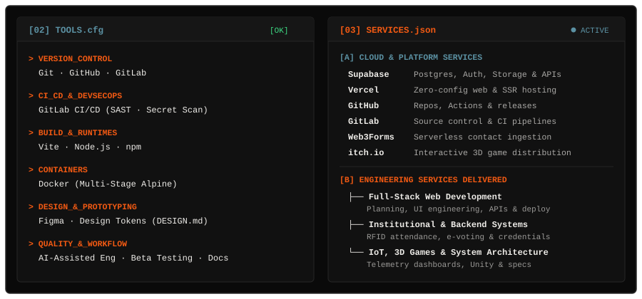
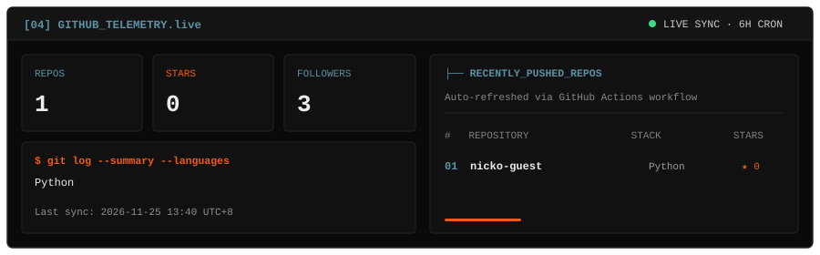

  

  
  
  
  
  

> **Don Dominick Enargan** — Full-Stack, Backend & Systems Developer based in **Davao, Philippines (`UTC+8`)**. B.S. Information Technology student at **Davao del Norte State College ('27)**, **DOST-SEI Scholar**, consistent **Dean's Lister**, and **Founder & President of CoDeX**.

---

### `[01]` Tech Stack

  

<code>[+] cat TECH_STACK.txt</code> — Accessible plain-text stack breakdown

- **Languages:** `TypeScript` · `JavaScript` · `Python` · `PHP` · `C#` · `Java` · `SQL (MySQL / Postgres)` · `HTML5` · `CSS3`
- **Frameworks & Libraries:** `React` · `Next.js` · `React Router (v7 SSR)` · `Tailwind CSS` · `Laravel` · `Motion`
- **Specialized Systems:** IoT Telemetry & Hardware Integration (RFID, environmental probes, closed-loop relays) · Unity 3D Game Development · Applied ML (Random Forest) · Mobile Applications

---

### `[02] & [03]` Tools & Services

  

<code>[+] cat TOOLS_AND_SERVICES.txt</code> — Accessible tools &amp; services list

- **Tools & Workflow:** `Git` · `GitHub` · `GitLab CI/CD` (SAST, Secret & Dependency Scanning) · `Vite` · `Node.js` · `npm` · `Docker` (multi-stage Alpine) · `Figma` · AI-Assisted Engineering · Beta Testing · Technical Documentation
- **Cloud & Platform Services:** `Supabase` · `Vercel` · `GitHub` · `GitLab` · `Web3Forms` · `itch.io`
- **Engineering Services Delivered:**
  - **Full-Stack Web Development** — End-to-end planning, UI engineering, APIs, and deployment
  - **Institutional & Backend Systems** — RFID attendance, digital elections, QR verification, and auditable credentials
  - **IoT & Smart Monitoring Solutions** — Sensor ingestion, automated relay control, and alert dashboards
  - **3D Game & Interactive Media** — Educational simulations and gameplay systems in Unity
  - **System Architecture & Documentation** — Relational schemas, technical specs, and maintainability docs

---

### `[04]` Live Telemetry & Shipped Builds

  

| # | Project | Role & Focus | Link |
| :--- | :--- | :--- | :--- |
| `01` | **CODEx & IC-LSG IC Systems** | Founder & Lead Dev · RFID Attendance, VoteFox & Mobile | [AMS Repo](https://gitlab.com/donenargan/ic-lsg-attendance-management-system) · [Mobile Repo](https://gitlab.com/donenargan/ic-lsg-mobile-app) |
| `02` | **AgriSense** | Full-Stack & Systems · IoT Grain Warehouse & Milling ML | — |
| `03` | **Quartz** | Full-Stack · Zero-Trust QR Events & Credentials | — |
| `04` | **Campus Tech: The ICT Journey** | Team Lead & Programmer · Unity 3D EdTech Game (DTI YC2) | [Play on itch.io](https://guestnicko.itch.io/campus-tech-the-ict-chronicles?secret=j3FlzqT9Ipb42y3LRBHarGwFuo) |
| `05` | **VoteFox (IC-LSG VMS)** | Lead Developer · Transparent Student Elections | — |
| `06` | **TerraPinas** | Author · Apartment Listing & Rental Management | [Live on Vercel](https://terra-pinas.vercel.app/) |

---

### `[05]` Contact Details

  

| Channel | Details | Link |
| :--- | :--- | :--- |
| **Email** | `donenargan@gmail.com` | [Send an email](mailto:donenargan@gmail.com) |
| **Location & Timezone** | Davao, Philippines (`Asia/Manila`, `UTC+8`) | — |
| **Availability** | Open to freelance projects, internships & collaborative builds | [Email for inquiries](mailto:donenargan@gmail.com?subject=Project%20Inquiry) |
| **GitHub** | `@nicko-guest` | [github.com/nicko-guest](https://github.com/nicko-guest) |
| **GitLab** | `@donenargan` | [gitlab.com/donenargan](https://gitlab.com/donenargan) |
| **LinkedIn** | Don Dominick Enargan | [linkedin.com/in/don-dominick-enargan-791815359](https://www.linkedin.com/in/don-dominick-enargan-791815359/) |
| **itch.io** | `guestnicko` | [guestnicko.itch.io](https://guestnicko.itch.io/) |
| **Instagram** | `@_its_nck_1` | [instagram.com/_its_nck_1](https://www.instagram.com/_its_nck_1/) |
